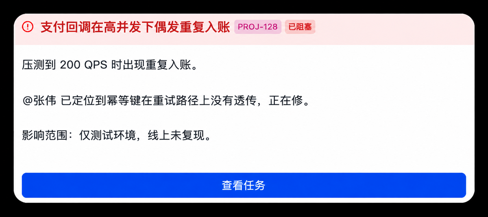
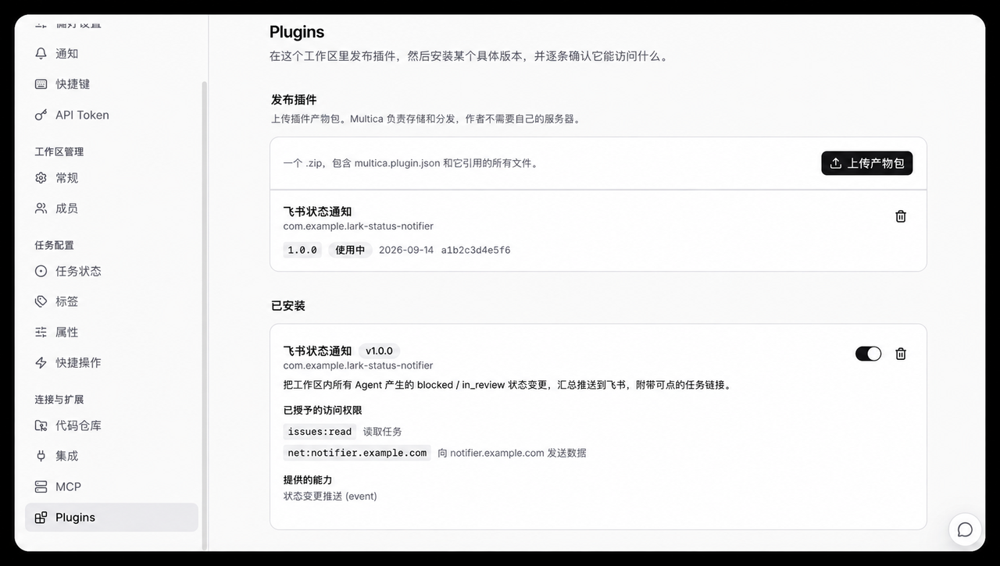

# multica-lark-notifier

把 [Multica](https://github.com/multica-ai/multica) 全工作区的 `blocked` /
`in_review` 状态变更，汇总推送到一个飞书机器人。

不改 Multica 一行代码——通过平台的 Plugin 事件钩子接入。



```
Multica ──POST(HMAC 签名)──▶ 本服务 ──▶ 过滤 ──▶ 飞书
                              │
                     签名不过 → 401
                     无需推送 → 200 {"status":"ignored"}
```

## 解决什么问题

Multica 原生的飞书集成是「一个 Bot 绑一个 Agent 的双向对话」，做不到把全工作区
的状态变更汇总到一处。三条依据（对 v0.4.38 / v0.4.43 源码实查）：

1. `channel_installation` 的唯一键是 `(workspace_id, agent_id, channel_type)`，
   一个飞书 App 只能绑一个 Agent
2. `lark/outbound.go` 的 `Register()` 只订阅 `task:failed` / `chat:done` /
   `task:cancelled`，且 `processEvent` 在 `!chatSessionID.Valid` 时直接返回——
   而 issue 状态流转没有 chat session
3. 五个 IM 适配器里只有企业微信订阅了 `inbox:new`，飞书/Slack/钉钉/Telegram 都没有

平台已有 `issue.status_changed` 事件和 Plugin hook 机制，所以走这条路：
订阅事件 → 本服务接收、验签、过滤 → 转发飞书。

上游讨论见 [multica-ai/multica#8380](https://github.com/multica-ai/multica/issues/8380)，
配套的通用实现见 [#8384](https://github.com/multica-ai/multica/pull/8384)。

## 快速开始

### 1. 准备 Multica 侧

backend 需要四个环境变量（缺任何一个都是**静默失败**，没有醒目报错）：

| 变量 | 值 | 不配的后果 |
|---|---|---|
| `FF_PLUGINS_V1` | `true` | 默认 false，事件在 dispatch 第一行就 return |
| `MULTICA_PLUGIN_SECRET_KEY` | **base64**，解码后正好 32 字节<br>`openssl rand -base64 32` | `hooks are disabled` |
| `MULTICA_PLUGIN_DEV_ORIGINS` | `https://<你的域名>` | 内网地址被 `isPublicAddress` 拒绝 |
| `MULTICA_PLUGIN_DIR` | 插件目录（仅本地源发布需要） | 本地发布找不到 bundle |

这些 flag 在进程启动时一次性读取，**改完必须重启 backend**。

### 2. 准备回调地址

Multica 在**发布 manifest 时**就要求 `transport.url` 是 HTTPS
（`plugincontract.validateHTTPSURL`，没有 dev 旁路），所以内网部署也得有 HTTPS。

最省事的做法是复用一个已有可信证书的域名，在网关上加一条子路径反代：

```nginx
location = /issue-callbacks {
    proxy_pass http://127.0.0.1:8787/issue-callbacks;
    proxy_http_version 1.1;
    proxy_set_header Connection "";
    # 签名覆盖整个 body，关缓冲避免大 description 落磁盘
    proxy_request_buffering off;
    client_max_body_size 2m;
}
```

比自签证书 + `MULTICA_PLUGIN_DEV_CA` 少一次 backend 重启。

### 3. 打包安装插件

用打包脚本生成产物包，参数是回调服务的域名：

```bash
./scripts/build-bundle.sh notifier.yourcompany.com
# 自定义回调路径：
./scripts/build-bundle.sh notifier.yourcompany.com /hooks/multica
```

产物在 `dist/lark-status-notifier-<版本>.zip`。

脚本会替你处理三件容易出错的事：

- 把域名同时写进 `net:` scope 和 `transport.url`（两处必须**逐字一致**，
  运行时 `hostInNetScopes` 是精确字符串比较，没有通配）
- 文件命名为 `multica.plugin.json`（叫 `manifest.json` 会被判定为缺少 manifest）
- 提前拦截不合法的域名，比传上去被拒再猜快

**为什么不提供预编译的 release**

因为域名无法留空后填。`net:` scope 的值要通过 `netDomainPattern`，
占位符如 `REPLACE_ME` 在 `ParseManifest` 阶段就被拒：

```
scopes[1]: net scope has an invalid domain "REPLACE_ME"
```

加上 `validateHTTPSURL` 要求 URL 带真实 hostname、运行时又是精确比较，
所以每个部署必须打自己的包——一个通用 release 谁下载了都得改了重打。

#### 包里有什么

只有一个 932 字节的声明文件：

```
Archive:  lark-status-notifier-1.0.0.zip
  Length      Name
      932     multica.plugin.json
```

**不含任何密钥、凭据或服务代码。** 它只告诉 Multica「往这个地址发事件」。
`key` 字段是插件标识符（类似包名），不是密码。

三样东西是分开存放的：

| 东西 | 位置 |
|---|---|
| 插件声明（本 zip） | 上传给 Multica |
| `whsec_` 签名密钥 | 安装后生成，填在回调服务的 `.env` |
| 飞书 app_secret | 回调服务的 `.env`（权限 600） |

所以这个 zip 即使公开也不泄露任何东西。

#### 在 Multica 里上传

进入 **设置 → 连接与扩展 → Plugins**，在「发布插件」里点「上传产物包」，
选择 `dist/` 下的 zip；上传成功后从「已安装」区域安装，逐条确认两个权限。

带截图的详细步骤见文末[附：上传与安装插件包（图解）](#附上传与安装插件包图解)。

> **上传被拒的常见原因**
>
> - 文件名写成了 `manifest.json`（必须是 `multica.plugin.json`）
> - `transport.url` 不是 HTTPS —— 发布期就会拒，`DEV_ORIGINS` 救不了
> - `net:` scope 的域名没有点，例如直接写了 Docker 服务名
>
> 用打包脚本可以避开前两条，第三条脚本会提前报错。

### 4. 拿签名密钥

安装页面会展示一次 `whsec_...`。**如果错过了，它不存库，但可以推导**：

```python
key = base64.b64decode(MULTICA_PLUGIN_SECRET_KEY)   # 32 字节
mac = hmac.new(key, b"multica-plugin-hook-signature:v1:", hashlib.sha256)
mac.update(installation_id.encode())    # SELECT id FROM plugin_installation
secret = "whsec_" + mac.hexdigest()
```

`plugin_secret` 表为 0 行是正常的——那张表存的是插件自己的 secret，不是 hook 签名密钥。

### 5. 起服务

```bash
cp .env.example .env      # 填入下表变量
chmod 600 .env
docker compose up -d
```

## 配置

**所有变量零默认值，缺失即拒绝启动。** 写默认值等于把某个具体部署烙进代码，
换环境跑会静默指向错误实例。

| 变量 | 必填 | 说明 |
|---|---|---|
| `MULTICA_HOOK_SECRET` | 是 | `whsec_<hex>`，不设拒绝启动，无跳过校验的开关 |
| `MULTICA_APP_URL` | 是 | Multica 地址，用于拼任务链接 |
| `MULTICA_WORKSPACE_SLUG` | 是 | 工作区 slug |
| `MULTICA_HOOK_PATH` | 是 | 回调路径，须与 manifest 中一致 |
| `LARK_APP_ID` / `LARK_APP_SECRET` | 二选一 | 直调飞书 OpenAPI |
| `LARK_WEBHOOK_URL` | 二选一 | 群自定义机器人（备用通路） |
| `LARK_BOT_TARGET` | 是 | 投递目标 `ou_` 或 `oc_` |
| `BIND_HOST` / `NOTIFIER_PORT` | 是 | 容器内用 `0.0.0.0` |

容器内**不用 lark-cli**，直调 OpenAPI：容器里没有它的二进制，凭据也在宿主机
keychain 里，挂进去等于让长期凭据落盘。

## 测试

```bash
docker run --rm -v "$PWD":/app -w /app python:3.12-slim \
  python3 -m unittest discover -s tests
```

68 项，纯标准库，无第三方依赖。

其中几项是**守卫性**的，防止回归：

- 仓库内不得出现真实域名 / 飞书 ID / 内部主机名（扫描全仓库，不只是源码包）
- 配置不得有实例相关的默认值
- 每个必填变量缺失时报错必须点名它

## 契约要点

这些都是实际踩出来的，不是推测：

**签名**

```
派生：HMAC-SHA256(部署密钥, "multica-plugin-hook-signature:v1:" + installation_id)
      → "whsec_" + hex
签名：HMAC-SHA256(whsec_ 解码后的原始字节, timestamp + "." + body)
头部：X-Multica-Signature: v1=<hex>
      X-Multica-Timestamp: <unix 秒>
```

- **key 是 raw bytes**：`whsec_` 后的 hex 要解码回字节，拿 hex 字符串当 key 恒不匹配
- **`v1=` 前缀是出站时加的**，`SignHookPayload` 返回裸 hex。自己造测试请求时
  要手动补，否则得到 401 会误以为实现有问题
- **时间戳容差要双向**：只挡「过旧」的话，签一个远未来时间戳就是长期通行证

**payload**

- 业务数据在信封的 **`input`** 字段里，不在顶层
- `input.status_changed` 必须为 `true`（平台对 `issue.updated` 和
  `issue.status_changed` 派发同一个 payload，靠这个标志去重）
- 需要 `issue.id`，只给 `identifier` 会被当残缺数据丢弃
- 按 **`status_category`** 而非 `status` 过滤：自定义状态的 key 可能是
  `in_review_2` 这种不透明句柄，但分类是已知集合。该字段带 `omitempty`，
  缺失时回退到 `status`

**响应**

- **不需推送也要回 2xx**：回错误码会触发平台重试，并把一个正常的「无需推送」
  计入熔断器失败计数
- **401 不说明具体原因**，详细原因记日志——给爆破者反馈等于送情报

**飞书**

- 业务失败也返回 HTTP 200，错误在 body 的 `code` 里。只看状态码会把
  「机器人被移出群」当成功
- Multica 的 `mention://member/<uuid>` 飞书不认识，会渲染成点不动的死链，
  要压成纯文本

## 交叉验证

签名实现**没有自签自验**。做法是在上游仓库 `server/cmd/` 下放一个临时程序
（用完即删，工作树 0 改动），import 其 `internal/service` 调真实的
`SignHookPayload` 生成签名，再交给本仓库的 Python 实现校验。

同理，manifest 在上传前用上游的 `ParseBundle` + `Validate()` 验过，
而不是发上去被拒再猜。

## 结构

```
notifier/
  server.py      HTTP 入口，验签 → 解析 → 投递
  signature.py   HMAC 校验，含时间戳双向容差
  events.py      事件过滤与字段提取
  lark.py        卡片渲染
  lark_api.py    飞书 OpenAPI 直调，token 缓存 + 提前续期
  identity.py    邮箱 → open_id 双信道解析
  config.py      零默认值配置加载
plugin/
  manifest.json  插件声明模板
tests/           68 项
```

## 附：上传与安装插件包（图解）

打好包之后，在 Multica 里的操作界面长这样 —— **设置 → 连接与扩展 →
Plugins**：



页面分两段，对应两个独立步骤：

**① 发布插件** —— 点右上角「上传产物包」，选择 `dist/` 下的 zip。
上传的是一个 `.zip`，里面包含 `multica.plugin.json` 和它引用的所有文件。
Multica 负责存储和分发，**不需要你自己搭一个托管插件包的服务器**
（回调服务是另一回事，那个仍然要你自己跑）。

上传成功后这里会列出插件名、标识符、版本、上传日期和内容摘要。

**② 已安装** —— 从上面发布的版本里点安装。安装时会逐条列出插件申请的
权限，要你确认：

| 权限 | 含义 |
|---|---|
| `issues:read` | 读取任务（标题、状态） |
| `net:<你的域名>` | 只能向这一个域名发送数据 |

装好后这一段会显示插件的启用开关、描述、已授予的权限，以及它提供的能力
（这里是「状态变更推送 (event)」）。确认开关是打开的。

### 这个页面上的排障信息

插件卡片里会显示最近的 hook 调用失败，例如：

```
最近有 1 次 hook 调用失败。
hook endpoint is not allowed
```

这条特别值得认识 —— 它的意思是 **Multica 拒绝了自己的出站请求**，
而不是你的服务返回了错误。原因是 `transport.url` 的域名不在
`MULTICA_PLUGIN_DEV_ORIGINS` 里，请求在发出前就被拦下了，
你的回调服务**根本不会收到任何东西**，日志里也不会有痕迹。

改完 `DEV_ORIGINS` 需要重启 backend 才生效。修好后这条告警不会自动消失，
它是历史记录 —— 用一次真实的状态变更验证是否恢复，别盯着告警看。

其他常见提示：

- `hook endpoint is not allowed` → 域名不在 `DEV_ORIGINS`（见上）
- 上传时报缺少 manifest → 文件名不是 `multica.plugin.json`
- 上传时报 `must be a plain HTTPS URL` → `transport.url` 不是 HTTPS
- 上传时报 `net scope has an invalid domain` → 域名没有点或含大写字母

## 许可

MIT
